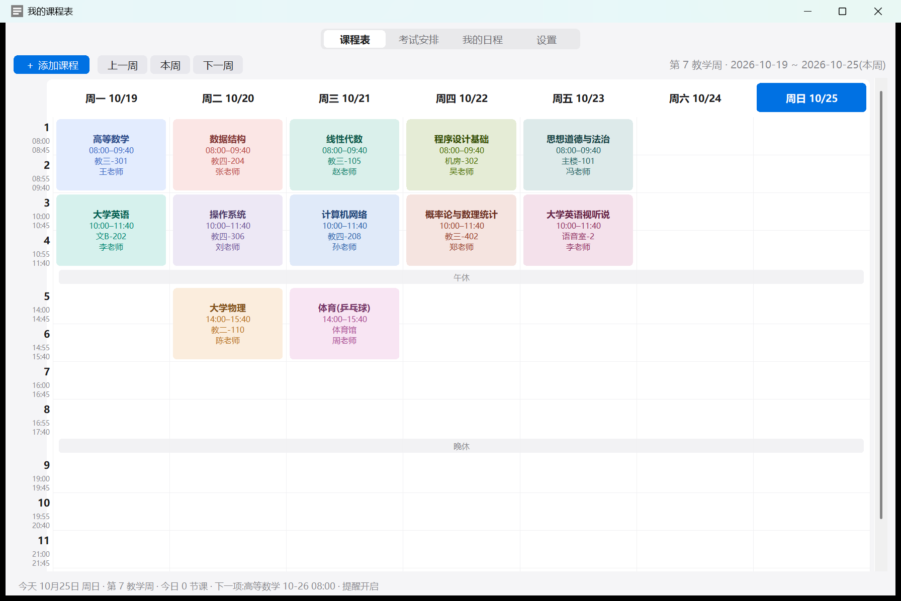

# 我的课程表 · Course Schedule

一款 **Windows 桌面课程表应用**,使用 Python + Tkinter 编写,**零第三方依赖**,单文件即可运行。

苹果风格界面 · 节次制周视图 · 考试倒计时 · 自定义日程 · Windows 系统通知提醒

## ✨ 功能

- **📅 课程表**
  - 按"节次"展示每周课程,左轴标注每节课的精确起止时间,自动插入午休 / 晚休时间带
  - 每门课程一种颜色(马卡龙配色),显示上课时间、教室、教师
  - 支持周次范围(如 `1-16`),非本周课程自动隐藏,到周自动出现
  - 自动高亮今天,红色时间线实时指示当前时刻
  - 支持翻看上一周 / 下一周
- **📝 考试安排** — 列表管理,自动倒计时,临近 3 天标红
- **🗓️ 我的日程** — 任意自定义事项,每条可单独设置提前提醒时间
- **⏰ 提醒** — 课程 / 考试 / 日程在开始前按设定的提前量弹出 **Windows 系统通知**,每条只提醒一次,错过不再补发
- **⚙️ 设置** — 默认提前量、学期第一周(自动计算教学周)、开机自启、测试通知
- **💾 数据** — 本地 JSON 存储,一键导出 / 导入备份,换电脑不丢数据
- **🖥️ 体验** — 高 DPI 适配(高分屏不发虚)、单实例保护、防重复提醒

## 🖼️ 截图



## 🚀 运行

**环境要求**:Windows 10 / 11,Python 3.9+(仅标准库,无需 `pip install`)

```bash
# 方式一:直接双击 课程表.pyw(推荐,无命令行窗口)

# 方式二:命令行运行
pythonw 课程表.pyw
```

首次运行后建议:

1. 到「设置」页填写**学期第一周的周一**日期(用于计算教学周)
2. 在各页添加你的课程、考试与日程
3. 勾选**开机自动启动**,保证提醒不漏

## 🧩 适配你学校的作息

作息时间在源码顶部的两个常量中,按需修改即可:

```python
PERIODS = [
    (1, "08:00", "08:45"), (2, "08:55", "09:40"),
    (3, "10:00", "10:45"), (4, "10:55", "11:40"),
    # ...每节课的起止时间
]
BREAK_AFTER = {4: "午休", 8: "晚休"}   # 在第几节后插入休息带
```

课程会自动按节次对齐放置,无需关心像素坐标。

## 📦 数据说明

- 数据文件位置:`%APPDATA%\课程表\data.json`
- 程序日志:`%APPDATA%\课程表\app.log`
- 「设置 → 导出备份」可将全部数据打包为一个 JSON 文件,「导入备份」在另一台电脑恢复

## 📄 License

[MIT](LICENSE)
